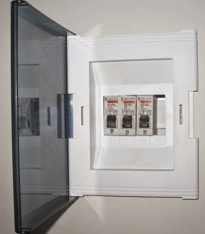
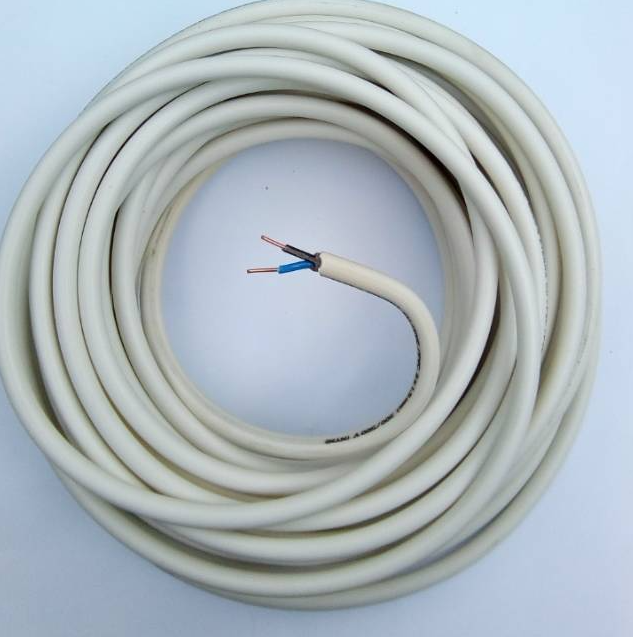
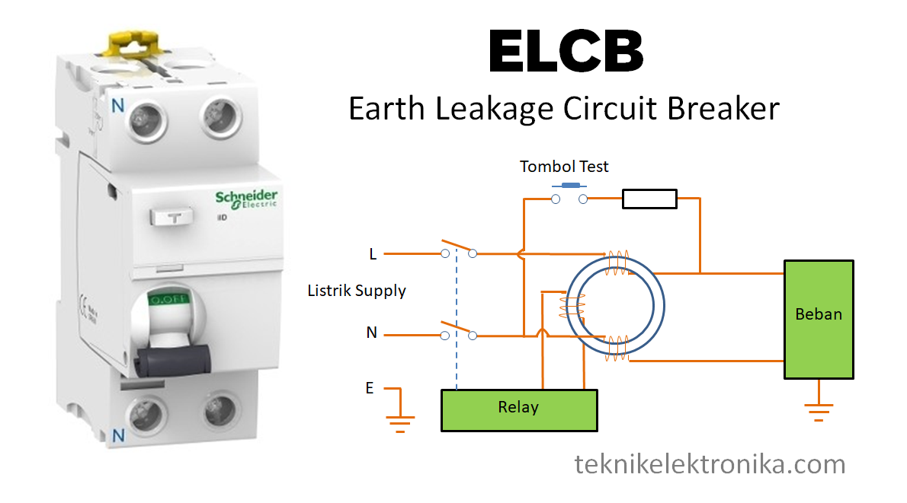
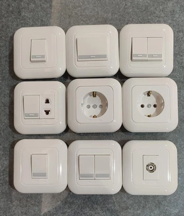

Membeli rumah baru adalah salah satu pencapaian terbesar dalam hidup. Saat melakukan survei atau serah terima kunci (*handover*), mata kita biasanya langsung tertuju pada hal-hal yang tampak di permukaan: keramik yang mengilap, cat dinding yang mulus, desain fasad yang estetik, hingga keran air yang mengalir lancar.

Namun, ada satu elemen vital yang tersembunyi di balik dinding kokoh dan plafon indah tersebut, yang sering kali luput dari perhatian hingga masalah besar terjadi: **sistem instalasi kelistrikan**.

Ibarat pembuluh darah di dalam tubuh manusia, instalasi listrik yang buruk tidak terlihat dari luar, namun bisa memicu "serangan jantung" berupa listrik yang terus-menerus anjlok (*jeglek*), rusaknya peralatan elektronik mahal, tagihan membengkak akibat arus bocor, hingga ancaman paling fatal: **kebakaran rumah akibat korsleting**.

Mengacu pada standar **PUIL 2020 (Persyaratan Umum Instalasi Listrik)** dan **SNI (Standar Nasional Indonesia)**, berikut adalah panduan lengkap yang dikemas secara sederhana mengenai hal-hal kelistrikan yang wajib Anda periksa sebelum menandatangani berita acara serah terima rumah baru.

**Konsultasi & Jasa Cek Listrik Rumah Baru via WhatsApp:** [https://wa.me/6282219814144?text=Halo,%20saya%20ingin%20konsultasi%20jasa%20inspeksi%20dan%20pengecekan%20kelistrikan%20rumah%20baru](https://wa.me/6282219814144?text=Halo,%20saya%20ingin%20konsultasi%20jasa%20inspeksi%20dan%20pengecekan%20kelistrikan%20rumah%20baru)

## 7 Titik Kritis Kelistrikan yang Wajib Diperiksa pada Rumah Baru

Agar Anda tidak terjebak membeli "kucing dalam karung", pastikan Anda atau tim inspeksi mendampingi pemeriksaan pada 7 aspek utama berikut ini:

### 1. Kotak Panel MCB & Pembagian Grup Jalur Listrik

Cobalah buka kotak sekring atau *box* MCB (*Miniature Circuit Breaker*) di dalam rumah—biasanya terletak di dekat pintu utama atau ruang tengah. Rumah yang dirancang dengan baik tidak hanya mengandalkan satu MCB di dalam rumah.

**Pembagian Grup (Grouping)**\
Pastikan jalur listrik dibagi menjadi beberapa MCB terpisah (misal: grup lampu, grup stopkontak, dan grup khusus AC/Water Heater). Jika terjadi gangguan di satu kamar, seluruh rumah tidak ikut gelap gulita.

**Kesesuaian Kapasitas Daya**\
Pastikan daya dari kWh meter PLN (misal 1.300 VA atau 2.200 VA) sudah sesuai dengan gaya hidup keluarga Anda, terutama jika Anda berencana menggunakan kompor induksi, beberapa unit AC, atau pompa pendorong.

**Labeling & Kerapian**\
Instalatur profesional selalu memberikan label keterangan yang jelas pada setiap tuas MCB dan menyusun kabel di balik papan panel dengan rapi menggunakan *busbar* tembaga, bukan sekadar lilitan kabel manual.

### 2. Kualitas & Spesifikasi Kabel di Atas Plafon

Banyak kasus oknum pemborong nakal yang memangkas anggaran dengan menggunakan kabel "banci" (ukuran tembaga lebih kecil dari tulisan di bungkusnya) atau menyambung kabel tanpa pelindung di atas plafon.

**Wajib Kabel Tembaga Murni Ber-SNI**\
Untuk instalasi tetap di dalam dinding dan plafon, pastikan menggunakan kabel jenis **NYM** (berisolasi ganda putih) atau **NYA** di dalam pipa pelindung dengan merek berstandar SNI/LMK (seperti Eterna, Supreme, Extrana, atau Kabelmetal). Ukuran minimal untuk jalur stopkontak adalah **2.5 mm²**.

**Pelindung Pipa Conduit & T-Dus**\
Intip ke balik lubang plafon (*manhole*). Kabel tidak boleh dibiarkan tergeletak telanjang di atas rangka plafon hollow karena sangat rawan digigit tikus. Seluruh kabel wajib masuk ke dalam pipa PVC *conduit* dan setiap sambungan harus tertutup rapat di dalam kotak *T-Dus*.

### 3. Sistem Pentanahan (Grounding) & Proteksi Anti-Kesetrum (ELCB)

Pernahkah Anda menyentuh bodi kulkas, mesin cuci, atau keran air *water heater* lalu merasakan sensasi "nyetrum" kecil di ujung jari? Atau tagihan token listrik habis sangat cepat padahal pemakaian wajar? Itu adalah tanda sistem *grounding* rumah Anda bermasalah atau bahkan **fiktif**!

> **Peringatan — Waspada Grounding Kosong pada Rumah Baru!**\
> Tidak sedikit rumah baru yang memiliki stopkontak 3 lubang (dengan kuningan *grounding*), namun ketika dibongkar bagian dalamnya, **kabel *grounding* (kuning-hijau) ternyata tidak dipasang sama sekali** atau hanya dipotong buntung di dalam tembok untuk menghemat biaya kabel.

Pastikan dua komponen penyelamat nyawa ini tersedia di rumah baru Anda:

**Kabel & Tombak Arde (Grounding System)**\
Berfungsi membuang kebocoran arus listrik dan induksi petir langsung ke dalam tanah. Berdasarkan PUIL, nilai tahanan tanah (*earth resistance*) yang baik adalah di bawah **5 Ohm** dan wajib terhubung dengan kabel ketiga (warna kuning-hijau) di setiap stopkontak.

**Perangkat ELCB / RCCB (Anti-Kontak)**\
MCB biasa hanya memutus listrik saat korsleting atau kelebihan beban, **bukan saat ada orang kesetrum**. ELCB (*Earth Leakage Circuit Breaker*) bersensitivitas 30mA akan langsung memutus aliran listrik dalam hitungan milidetik jika mendeteksi kebocoran arus ke tubuh manusia atau ke dinding yang lembap.

### 4. Kualitas, Posisi & Keamanan Stopkontak dan Sakelar

Jangan anggap remeh titik colokan listrik. Penempatan dan kualitas stopkontak sangat menentukan kenyamanan serta keamanan keluarga, terutama jika Anda memiliki anak kecil:

**Kepadatan & Cengkeraman Pin**\
Cobalah mencolokkan steker ke seluruh stopkontak. Stopkontak berkualitas rendah terasa longgar dan menimbulkan percikan api (*spark*). Pilih yang memiliki fitur *Child Protection Shutter* (penutup lubang otomatis).

**Area Basah & Outdoor (IP Rating)**\
Stopkontak di kamar mandi, taman, *carport*, atau dekat area cuci wajib menggunakan penutup tahan cipratan air (*weatherproof cover* minimal berstandar IP44/IP55) agar terhindar dari korsleting akibat air.

**Jarak Aman dari Sumber Air & Gas**\
Pastikan posisi stopkontak di meja dapur (*kitchen sink*) tidak berada persis di bawah keran air atau terlalu dekat dengan selang regulator kompor gas untuk menghindari pemicu kebakaran.

### 5. Kesiapan Masa Depan & Dokumen Legalitas (SLO)

Rumah adalah investasi jangka panjang. Pastikan kelistrikan rumah baru Anda siap mengakomodasi kebutuhan masa depan dan memiliki kepastian hukum:

**Sertifikat Laik Operasi (SLO) & As-Built Drawing**\
Setiap pemasangan listrik baru resmi wajib memiliki **SLO**. Selain itu, mintalah gambar jalur kabel (*As-Built Drawing* kelistrikan) kepada *developer* agar di kemudian hari Anda tidak salah mengebor kabel di dalam tembok saat ingin memasang paku atau *bracket* TV.

**Jalur Cadangan (Spare) untuk EV & Smart Home**\
Periksa apakah di dalam kotak MCB masih ada ruang kosong untuk penambahan jalur baru, misalnya jika Anda berencana memasang *Home Charging* mobil listrik (EV), panel surya atap, atau sistem *Smart Home*.

## Perbandingan Instalasi Listrik Rumah Standar vs Asal-Asalan

Masih ragu apakah instalasi listrik di rumah baru Anda sudah digarap dengan benar? Perbandingan berikut dapat menjadi acuan cepat Anda:

**1. Jalur Kabel Stopkontak**\
Pada instalasi standar aman (PUIL & SNI), jalur stopkontak menggunakan 3 tarikan kabel (Fasa, Netral, Grounding) ukuran 3 x 2.5 mm² tembaga murni. Sebaliknya, pada instalasi asal jadi atau berisiko tinggi, jalur ini hanya memakai 2 kabel (tanpa grounding) dengan ukuran tipis 1.5 mm² atau kabel serabut non-SNI.

**2. Kondisi di Atas Plafon**\
Pada instalasi standar aman (PUIL & SNI), kabel tertata rapi di dalam pipa PVC conduit, dan sambungan memakai lasdop atau konektor di dalam kotak T-Dus tertutup. Sebaliknya, pada instalasi asal jadi, kabel berantakan seperti "sarang laba-laba" dan sambungan hanya diisolasi plastik tipis di udara terbuka.

**3. Polaritas Fasa & Netral**\
Pada instalasi standar aman (PUIL & SNI), sakelar lampu selalu memutus jalur Fasa (api), sehingga saat sakelar mati, fiting lampu aman disentuh. Sebaliknya, pada instalasi asal jadi, pemasangan sering terbalik (memutus Netral), yang menyebabkan lampu LED tetap menyala redup atau berkedip saat dimatikan.

**4. Jalur Beban Berat (AC / Pemanas Air)**\
Pada instalasi standar aman (PUIL & SNI), beban berat memiliki jalur kabel tarik langsung (*dedicated line*) dan MCB tersendiri di panel utama. Sebaliknya, pada instalasi asal jadi, jalur ini hanya menyuntik atau mencabang langsung dari jalur kabel lampu terdekat yang berpenampang kecil.

**5. Tegangan & Drop Voltage**\
Pada instalasi standar aman (PUIL & SNI), tegangan stabil di kisaran 220V–230V saat beban puncak dinyalakan bersamaan. Sebaliknya, pada instalasi asal jadi, lampu langsung meredup saat kompresor AC atau pompa air menyala akibat sambungan kendor atau kabel kekecilan.

## 5 Langkah Praktis Cek Listrik Mandiri Saat Serah Terima Kunci

Sebelum masa garansi konstruksi (*retensi*) dari pengembang berakhir—biasanya berkisar 3 hingga 6 bulan sejak serah terima—lakukan langkah pengujian sederhana berikut ini:

**Langkah 1: Uji Pemutusan Grup MCB Satu per Satu**\
Nyalakan seluruh lampu di rumah, lalu matikan MCB di dalam boks panel satu per satu. Catat area mana saja yang mati untuk memastikan setiap MCB benar-benar bekerja dan tidak ada jalur yang salah sambung.

**Langkah 2: Cek Seluruh Titik Colokan dengan Socket Tester**\
Gunakan alat murah bernama *Socket Polarity Tester* (harga sekitar Rp50 ribuan di toko online) atau minimal *testpen* dan *charger* HP. Alat *Socket Tester* akan langsung memberi tahu melalui lampu indikator apakah kabel *grounding* terpasang atau tidak dalam waktu 2 detik!

**Langkah 3: Intip ke Dalam Lubang Plafon (Inspeksi Visual)**\
Gunakan tangga dan senter untuk mengintip melalui lubang akses plafon (*manhole*). Pastikan seluruh kabel terbungkus pipa *conduit* rapi dan tidak ada kabel terkelupas yang menempel pada rangka baja ringan.

**Langkah 4: Deteksi Kebocoran Arus pada kWh Meter Token**\
Cabut **semua** colokan elektronik dan matikan seluruh sakelar lampu, tetapi biarkan MCB tetap menyala (*ON*). Perhatikan layar kWh meter PLN Anda: jika muncul tulisan **"PERIKSA"** atau gambar tangan/gembok, berarti ada kebocoran arus atau kesalahan instalasi kabel di dalam rumah Anda.

**Langkah 5: Panggil Teknisi Ahli untuk Audit Menyeluruh (Megger & Earth Test)**\
Untuk kepastian 100%, gunakan jasa inspeksi kelistrikan profesional yang dilengkapi alat ukur ketahanan isolasi kabel (*Insulation Tester / Megger*), *Earth Tester* untuk mengukur nilai Ohm *grounding*, serta kamera termal (*Thermal Imager*) untuk mendeteksi titik panas tersembunyi.

## Pertanyaan yang Sering Diajukan (FAQ)

**Tanya: Kenapa lampu LED di rumah baru saya tetap menyala redup atau berkedip padahal sakelar sudah dimatikan?**\
**Jawab:** Kondisi ini umumnya terjadi karena pemasangan kabel Fasa (api) dan Netral terbalik pada sakelar. Seharusnya sakelar memutus arus Fasa, namun tukang justru memutus jalur Netral sehingga arus listrik masih mengalir ke lampu. Penyebab lainnya adalah induksi kabel atau kualitas grounding yang buruk. Hal ini perlu segera diperbaiki agar lampu LED tidak cepat putus.

**Tanya: Mengapa di layar meteran listrik token rumah baru saya muncul tulisan 'PERIKSA'?**\
**Jawab:** Tulisan 'PERIKSA' pada kWh meter prabayar muncul karena sistem sensor meteran mendeteksi ketidakseimbangan arus antara kabel Fasa dan Netral. Penyebab utamanya adalah adanya arus bocor ke dinding yang lembap, kabel grounding yang digabung dengan kabel netral secara salah, atau adanya sambungan kabel yang terkelupas di atas plafon.

**Tanya: Apakah rumah dari developer perumahan sudah pasti memiliki grounding dan ELCB yang aman?**\
**Jawab:** Sayangnya belum tentu. Demi menekan biaya produksi, banyak perumahan komersil maupun subsidi hanya memasang MCB standar tanpa ELCB, serta memasang grounding seadanya (bahkan terkadang kabel grounding di stopkontak tidak disambungkan ke tanah). Sangat disarankan untuk melakukan pengecekan ulang sebelum rumah dihuni.

**Tanya: Kapan waktu terbaik untuk melakukan inspeksi kelistrikan pada rumah baru?**\
**Jawab:** Waktu paling ideal adalah sebelum Anda menandatangani Berita Acara Serah Terima (BAST) atau selama masa garansi retensi bangunan masih berlaku (biasanya 90–180 hari pertama). Jika ditemukan cacat instalasi pada periode ini, Anda berhak menuntut pihak pengembang atau kontraktor untuk memperbaikinya tanpa biaya tambahan.

## Jangan Pertaruhkan Keselamatan Keluarga & Aset Rumah Baru Anda

Merasa ragu dengan kualitas instalasi listrik di rumah yang baru Anda beli atau bangun? Tim teknisi bersertifikasi kami siap membantu melakukan **Inspeksi & Audit Kelistrikan Rumah menyeluruh**, perbaikan jalur *grounding*, pemasangan proteksi anti-kesetrum (ELCB), hingga perapian panel MCB sesuai standar keselamatan PUIL.

**Jadwalkan Inspeksi Kelistrikan Rumah Sekarang:** [https://wa.me/6282219814144?text=Halo,%20saya%20ingin%20konsultasi%20jasa%20inspeksi%20dan%20pengecekan%20kelistrikan%20rumah%20baru](https://wa.me/6282219814144?text=Halo,%20saya%20ingin%20konsultasi%20jasa%20inspeksi%20dan%20pengecekan%20kelistrikan%20rumah%20baru)
