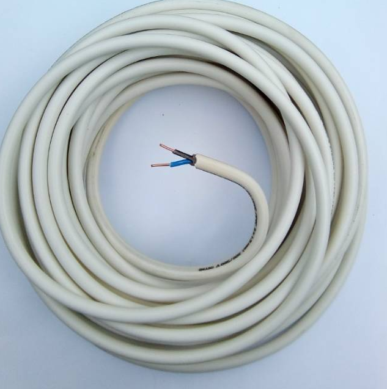

Paragraf pembuka. Artikel ini sengaja memuat **semua elemen** yang bisa muncul dari hasil impor Notion, supaya setiap variasi tampilan bisa diuji sekaligus. Ada juga *teks miring*, `kode pendek`, dan [tautan ke beranda](/).

## Judul tingkat dua pertama

Paragraf biasa di bawah judul. Panjang baris yang nyaman untuk dibaca sekitar 60–80 karakter, jadi kolom isi artikel sengaja dibuat sempit.

### Sub-judul tingkat tiga

- Butir daftar pertama
- Butir daftar kedua dengan **teks tebal**
  - Butir bertingkat
- Butir daftar ketiga

1. Langkah pertama
2. Langkah kedua
3. Langkah ketiga

### Gambar



## Kutipan dan callout

> "Instalasi listrik yang baik tidak terlihat. Yang terlihat hanya akibatnya kalau instalasinya buruk."

> **Peringatan — Contoh callout dari Notion**\
> Callout biasanya diawali baris tebal sebagai judul, lalu penjelasan di baris berikutnya.

## Tabel

| Komponen | Standar aman | Berisiko |
|---|---|---|
| Kabel stopkontak | 3 × 2.5 mm² tembaga | 2 × 1.5 mm² serabut |
| Proteksi | MCB + ELCB 30 mA | MCB saja |
| Grounding | Terpasang, < 5 Ω | Tidak ada |

## Kode

```txt
Grup 1: Lampu        MCB 6 A
Grup 2: Stopkontak   MCB 16 A
Grup 3: AC           MCB 10 A
```

## Pertanyaan yang Sering Diajukan (FAQ)

**Tanya: Apakah ini artikel sungguhan?**\
**Jawab:** Bukan. Artikel ini hanya ada di `src/prototype/content/posts/` dan tidak ikut build.

**Tanya: Kenapa ada begitu banyak judul?**\
**Jawab:** Supaya daftar isi di sidebar punya cukup isi untuk dinilai.

## Penutup

Paragraf penutup dengan ajakan, misalnya menghubungi tim untuk inspeksi.

---

*Catatan kaki kecil di akhir artikel.*
